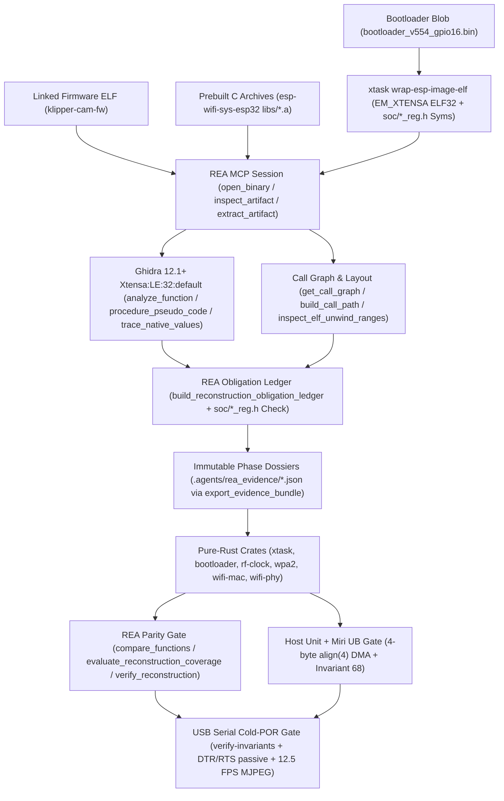

# Comprehensive REA-Driven Plan: 100% Pure Rust Firmware, Bootloader & Host Tooling (`esp32-camera`)

> [!NOTE]
> **Status (`Rule 22` Approval Gate)**: Approved by User on `2026-11-14`. Baseline: `master` @ `b097fde`.

---

## 1. Objective & Ground-Truth Baseline (`b097fde`)

Achieve **100.00% Pure Rust** across every software and binary layer of [`/home/console-admin/Github/esp32-camera`](/home/console-admin/Github/esp32-camera)—host tooling, `0x1000` 2nd-stage flash bootloader, and `0x20000`/`0x1D0000` bare-metal application firmware—eliminating every remaining Python script, Shell script, prebuilt ESP-IDF C bootloader binary blob, and precompiled Espressif C static archive (`*.a`) using the live **`rea` (`rea-agents` v`6.8.0`)** MCP plugin as the authoritative reverse-engineering, obligation-tracking, and parity-verification engine.

### What Is Already Pure Rust vs. What Remains Non-Rust

Although all `134` tracked source files in the repository contain zero `.c`, `.h`, `.cpp`, or `.S` files (`77` `.rs` files = `59,241` LOC), three non-Rust layers remain across the GitHub tree and the linked Xtensa firmware image:

| Layer | Target / Path | Verified Current State (`b097fde`) | Target Pure-Rust Crate | Phase |
|---|---|---|---|---|
| **Host Tooling (`2.59%` Linguist)** | 6 `.py` files (`1,337` LOC / `55,337` B) + 1 `.sh` file (`22` LOC / `973` B): `verify_cold_boot_invariants.py`, `ota_deploy.py`, `ensure_serial_passive.py`, `cloud-setup.sh`, `tests/*.py` | Runs host validation, USB DTR/RTS passive gate, OTA deployment, and invariant checks | `crates/xtask` (`cargo xtask`) | Phase 1 |
| **2nd-Stage Bootloader (`0x1000`)** | [`bootloader_v554_gpio16.bin`](file:///home/console-admin/Github/esp32-camera/firmware/bootloader_v554_gpio16.bin) (`26,256` B, `ESP-IDF v5.5.4`, compiled Oct 27 2026) | Prebuilt C blob implementing `GPIO 16` pull-up (`0x3FF4_904C = 0x2B00`), `SPI0/SPI1` PSRAM setup, `otadata` selection, MMU map | `crates/esp32-cam-bootloader` (`<= 28,672` B / `0x7000`) | Phase 2 |
| **Dead C Archives (`0` linked syms)** | `libbtdm_app.a` (`900,100` B), `libmesh.a` (`1,005,132` B), `libsmartconfig.a` (`200,502` B), `libwapi.a` (`52,718` B), `libcoexist.a` (`125,706` B) in `esp-wifi-sys-esp32-0.3.0` | **0** linked symbols in `klipper-cam-fw` (`1,652` defined symbols unreferenced; all 5 severed immediately) | *(None — dead link removal)* | Phase 3A |
| **Thin C Glue (`16` linked syms total)** | `libespnow.a` (`1` sym / `3` B), `libregulatory.a` (`2` syms / `752` B), `librtc.a` (`2` syms / `507` B), `libcore.a` (`5` syms / `140` B), `libprintf.a` (`6` syms / `303` B) | Only `1,705` linked bytes across 5 archives (`coex_bt_high_prio`, `temprature_sens_read`, `regdomain_table`, `misc_nvs_*`, `snprintf`) | `crates/esp32-cam-rf-clock` | Phase 3A |
| **WPA/EAPOL Supplicant (`209` linked syms)** | `libwpa_supplicant.a` (`5,322,806` B raw archive) | `35,370` B linked (`MD5*`, `SHA1*`, AES `Td0`/`Te0`, `__wpa_send_eapol`, 4-way handshake) | `crates/esp32-cam-wpa2` (audited RustCrypto `#![no_std]`) | Phase 3B |
| **802.11 STA MAC & LMAC (`1,449` linked syms)** | `libpp.a` (`569` syms / `67,045` B) + `libnet80211.a` (`880` syms / `167,369` B) | `234,414` B linked across `pp`/LMAC DMA rings and 802.11 STA state machine (`+` unused SoftAP dispatch stubs) | `crates/esp32-cam-wifi-mac` | Phase 3C |
| **2.4 GHz Baseband & RF PHY (`254` linked syms)** | `libphy.a` (`864,848` B raw archive) | `39,763` B linked (`bb_init`, `bb_reg_init`, `analog_gain_init`, `adc_ana_conf_org`, TX/RX cal) | `crates/esp32-cam-wifi-phy` (A/B feature gated first) | Phase 3D |

### Live Verified Baseline Evidence (Collected via Bounded Subagent Probe)

1. **Live REA `inspect_artifact` Baseline for [`bootloader_v554_gpio16.bin`](file:///home/console-admin/Github/esp32-camera/firmware/bootloader_v554_gpio16.bin)**:
   - **REA Evidence IDs**: `ev_106f1ba28b37a617749961893908c3ae7e87257ef880b76564f7995cf44b617e` (parent `ev_ff97a82b3a838988341f6ecea5d0e72ebcbee55082c159e0da39a58ddfeb9ef3`)
   - **Image Digest (SHA-256)**: `ba5710973d625b420b3bb44178f807131e89c7901ce1b3074879e9f810c4744d` (`26,256` B)
   - **Header & Integrity**: `chip_id = 0` (ESP32), `entry_addr = 0x4008065C`, `segment_count = 3`, `flash_mode = 2` (`DIO`), `flash_freq = 0` (`40 MHz`), `flash_size = 2` (`4 MB`), `wp_pin = 0xEE`, `descriptor.idf_ver = "v5.5.4"`, checksum `0x4F` (`valid`), appended SHA-256 `e15c9e689cd61392cbd63de5b0432ddfa89cf54d90c1b7f129af7077386901d9` (`valid`).
   - **Load Segment Map**:
     - Segment `0`: `load_addr = 0x3FFF0030`, `length = 6,280` B (`0x1888`), file offset `32` (DRAM)
     - Segment `1`: `load_addr = 0x40078000`, `length = 15,864` B (`0x3DF8`), file offset `6,320` (SRAM0 loader IRAM)
     - Segment `2`: `load_addr = 0x40080400`, `length = 4,016` B (`0x0FB0`), file offset `22,192` (IRAM startup/vectors)
2. **Linked ELF Symbol Attribution for [`klipper-cam-fw`](file:///home/console-admin/Github/esp32-camera/target/xtensa-esp32-none-elf/release/klipper-cam-fw)**:
   - Verified with `/home/console-admin/.rustup/toolchains/esp/xtensa-esp-elf/esp-16.2.0_20260914/xtensa-esp-elf/bin/xtensa-esp32-elf-nm`: `2,328` total defined global symbols in ELF, of which **`1,928` symbols (`311,112` B ELF symtab / `313,419` B archive symtab)** come from `/home/console-admin/.cargo/registry/src/index.crates.io-1949cf8c6b5b557f/esp-wifi-sys-esp32-0.3.0/libs/*.a`.
   - Total firmware flash image at `b097fde` is `802,144` B (`45.33%` of `1,769,472` B slot), meaning C Wi-Fi/PHY/WPA2 archives represent ~`38.8%` of the current firmware binary.
3. **Immutable Hardware Boundary — ESP32 Mask ROM (`0x4000_0000`)**:
   - Factory silicon Mask ROM (`esp-rom-sys`) is etched into ESP32 hardware rather than compiled C firmware shipped in flash. Software-reimplementable ROM calls (`crc32_le`, string/memory routines, delay loops) will be implemented natively in `#![no_std]` Rust (`core` / `compiler_builtins`); any silicon-coupled ROM entry points kept for cache/MMU synchronization will be isolated in one audited `rom_boundary.rs` module after verifying every alternative via `soc/*_reg.h` MMIO headers.

---

## 2. Target Architecture & REA Verification Pipeline

### Final Workspace Topology (`13` Pure-Rust Crates)

- **Host**: `crates/xtask` (`verify-invariants`, `ota-deploy`, `serial-passive`, `bootstrap-env`, `wrap-esp-image-elf`, `verify-pure-rust`)
- **Bootloader (`0x1000`)**: `crates/esp32-cam-bootloader` (`GPIO 16` pull-up, `RTC_WDT`, `SPI0`/`SPI1` `40 MHz DIO` + PSRAM setup, `partitions_rust_ota.csv`, `otadata` CRC32 & `PENDING_VERIFY` rollback, `DPORT` MMU table mapping, app jump)
- **Wi-Fi / RF Stack (replacing `esp-radio` + `esp-wifi-sys-esp32`)**:
  - `crates/esp32-cam-rf-clock` (PLL/BBPLL, clocks, regulatory tables, single-radio STA RF ownership)
  - `crates/esp32-cam-wpa2` (PBKDF2-HMAC-SHA1, RSN IE, 4-Way & 2-Way EAPOL handshakes, AES Key Unwrap, CCMP key slot plumbing)
  - `crates/esp32-cam-wifi-mac` (`WIFI_MAC` DMA descriptor rings, LMAC TX/RX/IRQ, 802.11 frame codec, STA FSM integrated with `ap_select`, rate control, `smoltcp::phy::Device`)
  - `crates/esp32-cam-wifi-phy` (Baseband, internal RF analog I2C bus calibration, TX power & channel tuning)
- **Existing Camera & App Crates (Retained & Hardened)**: `esp32-cam-types`, `esp32-cam-ll`, `esp32-cam-conversions`, `esp32-cam-sccb`, `esp32-cam-sensors`, `esp32-cam-hal`, `klipper-cam-fw`.

---

## 3. REA Host Prerequisites & Xtensa Reverse-Engineering Guardrails

Live `binary_session(detail="complete")` verification established that `/home/console-admin/.local/bin/rea` (`rea-agents` v`6.8.0`), Java 17 (`/usr/lib/jvm/temurin-17-jdk-amd64/bin/java`), `xtensa-esp32-elf-objdump`, `xtensa-esp32-elf-nm`, and `esp-artifact-graph` (`esp-image`, UNIX `ar`) are present, while `ghidra` and `pwntools` report `not_configured` / `provider_missing`. Phase 0 resolves both before decompilation begins, subject to four Xtensa-specific guardrails:

1. **ESP `0xE9` Raw Segment Limitation (`native-and-artifacts.md`)**: REA natively parses `esp-image` (`0xE9`) headers/segments via `inspect_artifact`, **but Xtensa segments cannot be opened directly as `raw-binary` in Ghidra**. Phase 1's `cargo xtask wrap-esp-image-elf` packages extracted `0xE9` segments (`0x3FFF0030`, `0x40078000`, `0x40080400`) into an `EM_XTENSA` (`94`) ELF32 container with exact load VMAs, entry address, and synthetic MMIO symbols sourced from `/home/console-admin/esp-matter-build/esp-idf/components/soc/esp32/register/soc/*_reg.h`.
2. **Ghidra `>= 12.1` Xtensa Support & Persistent Checkpoints**: Configure `GHIDRA_INSTALL_DIR` pointing to an extracted official Ghidra `>= 12.1` release (which includes native `Xtensa:LE:32:default` Sleigh + decompiler support), set `REA_GHIDRA_CHECKPOINT_DIR` to `/home/console-admin/Github/esp32-camera/.agents/rea_checkpoints` (gitignored), set `REA_GHIDRA_STARTUP_TIMEOUT_MS=900000`, and set `REA_PWNTOOLS_PYTHON` to a dedicated Python virtualenv containing `pwntools==4.15.0`.
3. **Xtensa Windowed ABI (`CALL8` / `ENTRY` / `L32R`)**: Pair Ghidra's `analyze_function` + `procedure_pseudo_code` with `/home/console-admin/.rustup/toolchains/esp/xtensa-esp-elf/esp-16.2.0_20260914/xtensa-esp-elf/bin/xtensa-esp32-elf-objdump` to verify literal pools (`L32R`), register-window rotations (`a0..a15`), and IRAM/DRAM boundary accesses.
4. **Stateful Single-Session REA Serialization**: Because `open_binary` / `close_binary` mutate one active `rea` MCP session (`mutatesSession`), never invoke concurrent subagents against live `rea` binary sessions. Run each REA extraction phase serially to produce an immutable `.agents/rea_evidence/<phase>_bundle.json` (`export_evidence_bundle`), then fan out parallel implementation subagents against that JSON evidence dossier.

---

## 4. Phased Implementation Plan

### Phase 0 — REA Deep-Analysis Environment & STA Reachability Ledger

- **Setup & Tooling Verification**:
  1. Install/extract official upstream Ghidra `>= 12.1` into `/home/console-admin/.local/share/ghidra/` and create `/home/console-admin/.local/share/rea-venv` with `pwntools==4.15.0`.
  2. Configure `rea` MCP environment variables: `GHIDRA_INSTALL_DIR`, `REA_GHIDRA_CHECKPOINT_DIR=/home/console-admin/Github/esp32-camera/.agents/rea_checkpoints`, `REA_GHIDRA_STARTUP_TIMEOUT_MS=900000`, `REA_PWNTOOLS_PYTHON`.
  3. Add `.agents/rea_checkpoints/` to [`.gitignore`](file:///home/console-admin/Github/esp32-camera/.gitignore) while tracking compact JSON obligation ledgers in `.agents/rea_evidence/`.
- **REA Call-Graph & Member Extraction**:
  1. Call `open_binary` on [`klipper-cam-fw`](file:///home/console-admin/Github/esp32-camera/target/xtensa-esp32-none-elf/release/klipper-cam-fw); run `inspect_rust_binary`, `inspect_binary_layout`, `inspect_elf_unwind_ranges`, `get_call_graph`, and `build_call_path` rooted at `esp_radio` FFI boundary calls.
  2. Enumerate the exact reachable call closure vs. dead SoftAP dispatch stubs inside the `1,928` linked C symbols (`TmpSTAAPCloseAP`, AP beacon/auth handlers).
  3. Call `open_binary` + `inspect_artifact` + `extract_artifact` on each active `.a` archive in `/home/console-admin/.cargo/registry/src/index.crates.io-1949cf8c6b5b557f/esp-wifi-sys-esp32-0.3.0/libs/` into `.agents/rea_checkpoints/extracted_objs/`.
  4. Export `.agents/rea_evidence/phase0_sta_reachability.json` (`export_evidence_bundle`) and call `close_binary`.
- **Gate**: `binary_session(detail="complete")` reports `ghidra: available` (`Xtensa:LE:32:default`) and `inspect_binary_layout: available`; `phase0_sta_reachability.json` accounts for 100% of the `1,928` linked archive symbols.

---

### Phase 1 — Pure-Rust Host Tooling (`crates/xtask`) -> `100%` GitHub Linguist Rust

- **Create `crates/xtask`** (`Cargo.toml`, `src/main.rs`, `src/verify_invariants.rs`, `src/ota_deploy.rs`, `src/serial_passive.rs`, `src/elf_wrap.rs`, `src/bootstrap_env.rs`, `src/pure_rust_audit.rs`, `tests/cli_parity.rs`):
  1. `verify-invariants`: 1:1 port of [`scripts/verify_cold_boot_invariants.py`](file:///home/console-admin/Github/esp32-camera/scripts/verify_cold_boot_invariants.py) preserving `AUTHORITATIVE_MMIO_REGISTERS` (verified against `/home/console-admin/esp-matter-build/esp-idf/components/soc/esp32/register/soc/*_reg.h`) and Invariants 70–72 checks.
  2. `ota-deploy`: 1:1 port of [`scripts/ota_deploy.py`](file:///home/console-admin/Github/esp32-camera/scripts/ota_deploy.py) (streaming HTTP `POST /update`, SHA-256 verification, `/status` confirmation wait).
  3. `serial-passive`: 1:1 port of [`scripts/ensure_serial_passive.py`](file:///home/console-admin/Github/esp32-camera/scripts/ensure_serial_passive.py) using `libc::ioctl` (`TIOCMGET`/`TIOCMBIC` clearing `TIOCM_DTR | TIOCM_RTS`, zero pulse per Invariant 69).
  4. `wrap-esp-image-elf`: converts `0xE9` ESP32 images into `EM_XTENSA` ELF32 binaries (`load_addr` program headers + `soc/*_reg.h` MMIO symbol table) for Ghidra/REA Phase 2 analysis.
  5. `verify-pure-rust`: asserts `0` non-Rust code/blob files in `git ls-files`, `0` C-blob `*-sys` dependencies in `Cargo.lock`, `0` GCC C `.comment` strings in linked Xtensa ELFs, and `100%` REA obligation coverage.
- **Differential Parity & Cleanup**:
  - Update workspace [`Cargo.toml`](file:///home/console-admin/Github/esp32-camera/Cargo.toml), `.cargo/config.toml` (`[alias] xtask`), [`.agents/skills/esp32-camera-dev/SKILL.md`](file:///home/console-admin/Github/esp32-camera/.agents/skills/esp32-camera-dev/SKILL.md), and [`.agents/rules/esp32-camera-workspace.md`](file:///home/console-admin/Github/esp32-camera/.agents/rules/esp32-camera-workspace.md).
  - Run differential parity tests (`cargo xtask verify-invariants` vs. `python3 scripts/verify_cold_boot_invariants.py` on both clean repo and synthetic violation fixtures; port all tests in [`tests/test_scripts.py`](file:///home/console-admin/Github/esp32-camera/tests/test_scripts.py) to `crates/xtask/tests/cli_parity.rs`).
  - Back up then remove all 6 `.py` files and `scripts/cloud-setup.sh`.
- **Gate**: `cargo test -p xtask --target x86_64-unknown-linux-gnu` passes; `cargo xtask verify-invariants` exits `0`; `git ls-files '*.py' '*.sh' '*.c' '*.h'` returns `0` files.

---

### Phase 2 — REA Reverse Engineering & Pure-Rust Reconstruction of `0x1000` 2nd-Stage Bootloader (`crates/esp32-cam-bootloader`)

- **Sub-Phase 2A — REA Decompilation & Ledger Extraction**:
  1. Run `cargo xtask wrap-esp-image-elf` on [`bootloader_v554_gpio16.bin`](file:///home/console-admin/Github/esp32-camera/firmware/bootloader_v554_gpio16.bin) -> `.agents/rea_checkpoints/bootloader_v554_gpio16.elf`.
  2. Open in REA (`open_binary`), run `list_procedures`, `get_call_graph`, `analyze_function`, `procedure_pseudo_code`, `trace_native_values`, and `build_reconstruction_obligation_ledger`.
  3. Record verified behavioral & MMIO obligations (cross-checked against `soc/*_reg.h` per Invariant 72):
     - Early `IO_MUX_GPIO16_REG` (`0x3FF4_904C = 0x2B00`) pull-up before `SPI0`/`SPI1` init (Invariant 70.1),
     - Early `RTC_WDT` (`0x3FF4_808C`) protection window (`t < 15 ms`),
     - eFuse chip/crystal/flash strapping decode, CPU PLL clock selection, UART0 `115200` logging,
     - `SPI0`/`SPI1` `40 MHz DIO 4 MB` flash + `CONFIG_SPIRAM` (`ESP-PSRAM`) detection/setup,
     - Partition table load (`0x8000`, `0x50AA` entries + `0xEBEB` MD5 check matching [`partitions_rust_ota.csv`](file:///home/console-admin/Github/esp32-camera/partitions_rust_ota.csv)),
     - `otadata` dual-sector (`0xE000`, `0xF000`) Espressif CRC32 decode, `NEW -> PENDING_VERIFY` state transition, automatic rollback (`PENDING_VERIFY -> ABORTED`), and `ota_0` (`0x20000`) / `ota_1` (`0x1D0000`) slot choice,
     - App `0xE9` image segment validation + optional SHA-256 verification, `DPORT_PRO_FLASH_MMU_TABLE` (`0x3FF1_0000`) IROM/DROM page mapping, IRAM/DRAM copy, cache enable, and jump to app `entry_addr`.
  4. Export `.agents/rea_evidence/phase2_bootloader_obligations.json` and close REA session.

- **Sub-Phase 2B — Pure-Rust `#![no_std]` Bootloader (`crates/esp32-cam-bootloader`)**:
  - Modules: `src/main.rs`, `src/gpio16.rs`, `src/wdt.rs`, `src/clock_spi_psram.rs`, `src/partitions.rs`, `src/otadata.rs`, `src/image_verify.rs`, `src/mmu_jump.rs`, plus `memory_bootloader.x`.
  - **Memory Map Guard**: Keep bootloader IRAM/DRAM strictly inside `0x4007_8000..0x4007_FFFF` (SRAM0 loader) and `0x3FFF_0000..0x3FFF_8000` (DRAM) so loading `klipper-cam-fw`'s `0x4008_0000+` IRAM and lower DRAM never overwrites active bootloader instructions before jump.
  - Pure logic (`partitions.rs`, `otadata.rs`, `image_verify.rs`) tested on host and verified under `cargo +nightly miri test -p esp32-cam-bootloader`.

- **Sub-Phase 2C — REA Parity & Cold-POR Hardware Certification**:
  - Build release binary (`-Zbuild-std=core`), package with `espflash save-image --chip esp32 --flash-mode dio --flash-freq 40m --flash-size 4mb`, and enforce **size `<= 28,672` B (`0x7000`)** so `0x1000..0x8000` never collides with the `0x8000` partition table.
  - Open compiled Rust bootloader in REA: run `inspect_artifact`, `compare_artifacts`, `compare_functions`, `evaluate_reconstruction_coverage`, and `verify_reconstruction` against `phase2_bootloader_obligations.json`.
  - Flash to `0x1000` over `/dev/serial/by-id/*` (`espflash write-bin`), set `cargo xtask serial-passive` (`DTR=0, RTS=0`), and certify: `10/10` physical USB unplug/replug `0V -> 5V` cold-POR boots, `ota_0 <-> ota_1` switch via `cargo xtask ota-deploy`, and synthetic unconfirmed `PENDING_VERIFY` rollback.
  - Once certified `[EXECUTED & VERIFIED]`, back up and retire [`firmware/bootloader_v554_gpio16.bin`](file:///home/console-admin/Github/esp32-camera/firmware/bootloader_v554_gpio16.bin).

---

### Phase 3 — REA Reverse Engineering & Staged Replacement of `esp-wifi-sys-esp32` Static Archives

Using a temporary workspace `[patch.crates-io]` seam around `esp-wifi-sys-esp32` during Phases 3A–3C (**Rule 5: One Variable Per Change**), each subsystem is independently REA-verified, linked, flashed, and tested before cutting the next.

#### Sub-Phase 3A — `crates/esp32-cam-rf-clock`: Sever 5 Dead Archives + Reconstruct Thin C Glue (`1,705` B)
1. **Dead Archive Removal**: Drop `-lbtdm_app`, `-lmesh`, `-lespnow`, `-lsmartconfig`, `-lwapi`, `-lcoexist` immediately in the patched link seam (`0` linked code symbols; replace `g_espnow_user_oui` 3-byte symbol or sever its single caller in `libnet80211.a`).
2. **REA Extraction**: Open `.o` objects from `librtc.a`, `libregulatory.a`, `libcore.a`, and `libprintf.a` (`16` total linked symbols = `1,705` B); run `analyze_function`, `procedure_pseudo_code`, `read_bytes`, and `build_reconstruction_obligation_ledger` -> `.agents/rea_evidence/phase3a_rf_clock_obligations.json`.
3. **Implementation (`crates/esp32-cam-rf-clock`)**:
   - Reconstruct `coex_bt_high_prio` (STA single-radio priority), `temprature_sens_read` (verified against `soc/sens_reg.h` / `soc/rtc_io_reg.h`), `regdomain_table` / `regulatory_data` (channels 1–14 EIRP limits), `g_log_level` / `misc_nvs_*` RAM stubs (obeying Invariant 70.4 zero boot-time flash I/O), and a temporary `#![no_std]` `snprintf`/`vsnprintf` formatter shim (removed in Phase 3D once `libpp.a`/`libphy.a` have zero C callers).
4. **Gate**: REA `compare_functions` + `verify_reconstruction` pass; Xtensa release build links cleanly with the 9 retired archives gone; live `ESP32-WROVER-DEV` joins Wi-Fi and streams 720p MJPEG.

#### Sub-Phase 3B — `crates/esp32-cam-wpa2`: Reconstruct WPA2-PSK Supplicant & Sever `libwpa_supplicant.a` (`5.1 MB` Archive / `209` Linked Symbols)
1. **REA Extraction**: Open [`klipper-cam-fw`](file:///home/console-admin/Github/esp32-camera/target/xtensa-esp32-none-elf/release/klipper-cam-fw) + extracted `libwpa_supplicant.a` `.o` members in REA (`analyze_function`, `procedure_pseudo_code`, `xrefs`, `trace_native_values`), mapping every FFI entrypoint and hardware crypto key-install callback -> `.agents/rea_evidence/phase3b_wpa2_obligations.json`.
2. **Implementation (`crates/esp32-cam-wpa2`, `#![no_std]`)**:
   - Use audited pure-Rust `#![no_std]` RustCrypto primitives (`sha1`, `hmac`, `pbkdf2`, `aes`, `ccm` — verified 0 CVEs) replacing bundled C `MD5*`, `SHA1*`, and AES `Td0`/`Te0` tables:
     - `pmk.rs`: `PBKDF2-HMAC-SHA1` (`4096` iterations; optional `build.rs` compile-time PMK precomputation for static `WIFI_SSID`/`WIFI_PASS`),
     - `rsn_ie.rs`: RSN IE (`0x30`, CCMP-128 / PSK) parser & builder,
     - `eapol_4way.rs`: 802.11i 4-Way Handshake (`M1`->`M2`->`M3`->`M4`) + 2-Way GTK group rekeying, strict replay counter monotonicity, ESP32 hardware TRNG (`soc/wdev_reg.h` `WDEV_RND_REG`, verified per Invariant 72) SNonce generation,
     - `hw_crypto_keys.rs`: REA-verified key-slot installation into `WIFI_MAC` CCMP hardware registers (plus pure-Rust software CCMP test implementation).
3. **Gate**: IEEE 802.11i & RFC 3394 test vectors + replay/malformed-IE fuzz tests pass under `cargo test` AND `cargo +nightly miri test -p esp32-cam-wpa2`; REA `verify_reconstruction` passes; `-lwpa_supplicant` removed; live WPA2-PSK association, group rekeying, and MJPEG stream verified on hardware.

#### Sub-Phase 3C — `crates/esp32-cam-wifi-mac`: Reconstruct STA 802.11 MAC & LMAC DMA; Sever `libpp.a` (`569` Syms) + `libnet80211.a` (`880` Syms) + `esp-radio`
1. **REA Extraction**:
   - Open `libpp.a` (`67,045` B linked) and STA-reachable `libnet80211.a` (`167,369` B linked) `.o` objects in REA (`get_call_graph`, `analyze_function`, `procedure_pseudo_code`, `trace_native_values`, `xrefs`).
   - Document every `WIFI_MAC` MMIO register (`soc/*_reg.h` cross-verified per Invariant 72, or formally verified from REA evidence + recorded in `AUTHORITATIVE_MMIO_REGISTERS`), TX/RX DMA descriptor word fields, hardware CCMP key-table slot format, RX filter bitmasks, interrupt sources, and TX rate retry counters -> `.agents/rea_evidence/phase3c_wifi_mac_obligations.json`.
   - *(Note: exclude SoftAP, WPS, P2P, and Enterprise handlers pulled in by `esp_wifi_init` dispatch tables in `libnet80211.a`; `klipper-cam-fw` operates strictly as a Wi-Fi STA client.)*
2. **Implementation (`crates/esp32-cam-wifi-mac`, `#![no_std]`)**:
   - `dma_ring.rs`: `#[repr(C, align(4))]` DMA TX/RX descriptor rings & internal-DRAM static packet pools (internal SRAM only—never PSRAM—for Wi-Fi MAC DMA), verified under `cargo +nightly miri test` (Invariant 68),
   - `lmac_mmio.rs`: `WIFI_MAC` MMIO controller, IRQ dispatch (`ETS_WIFI_MAC_INTR_SOURCE`), TX AC queues (`BE`/`VO`), RX replenishment, eFuse MAC address read,
   - `frames_80211.rs`: zero-copy `#![no_std]` 802.11 Management & QoS Data <-> Ethernet II (`LLC/SNAP`) codec, Miri-verified,
   - `sta_fsm.rs`: deterministic STA client state machine (`Scan(ch 1..13) -> ap_select -> Auth -> Assoc -> esp32-cam-wpa2 4-Way -> Connected`, `PowerSave::None` for low-jitter MJPEG, deauth/beacon-loss reconnect),
   - `rate_ctrl.rs`: adaptive 802.11n/g rate & retry table selector (`MCS0..MCS7` HT20 / OFDM fallback from LMAC TX status),
   - `smoltcp_phy.rs`: direct `smoltcp::phy::Device` adapter wired into [`crates/klipper-cam-fw/src/net_stack.rs`](file:///home/console-admin/Github/esp32-camera/crates/klipper-cam-fw/src/net_stack.rs), removing `esp-radio`.
3. **Gate**: `cargo +nightly miri test -p esp32-cam-wifi-mac`; REA `evaluate_reconstruction_coverage` + `verify_reconstruction`; `libpp.a` and `libnet80211.a` removed (only `libphy.a` remains in link seam for 1 isolated verification step); hardware DHCP + `>= 12.5 FPS` 720p MJPEG parity confirmed.

#### Sub-Phase 3D — `crates/esp32-cam-wifi-phy`: Reconstruct 2.4 GHz RF/Baseband PHY (`libphy.a`, `254` Linked Syms) & Delete All C Blobs
1. **REA Extraction**:
   - Open `libphy.a` `.o` objects in REA (`analyze_function`, `procedure_pseudo_code`, `trace_native_values`, `read_bytes`, `address_to_file_offset`).
   - Extract exact register init tables and calibration algorithms for `bb_init`, `bb_reg_init`, `analog_gain_init`, `adc_ana_conf_org`, `bb_wdt_int_enable`, internal RF I2C bus sequences, channel tuning (`ch 1..14`), RX DC / TX I/Q / TX power detector calibration, and periodic temperature compensation -> `.agents/rea_evidence/phase3d_wifi_phy_obligations.json`.
   - Enforce **Invariant 70.4**: RAM-only calibration state; zero boot-time flash reads/writes for PHY calibration data.
2. **Implementation (`crates/esp32-cam-wifi-phy`, `#![no_std]`)**:
   - Implement behind feature flag `pure-rust-phy` initially so differential A/B silicon comparison against `libphy.a` changes **exactly one variable** (Rule 4 & Rule 5).
   - Clamp all TX power register writes strictly below `esp32-cam-rf-clock::regulatory` per-channel EIRP limits before enabling PA stages.
3. **Hardware A/B Certification (`Invariant 64` & `Invariant 68`)**:
   - Compare `pure-rust-phy` vs. `b097fde` / Phase 3C baseline on the same `ESP32-WROVER-DEV`: RSSI within `+-2 dBm`, sustained `>= 12.5 FPS` 720p MJPEG stream over a 30-minute thermal soak, `0` watchdog resets, `10/10` passive-USB `0V -> 5V` cold-POR boots.
4. **Full Cutover**: Promote `pure-rust-phy` to unconditional default, remove `c_compat_fmt.rs` (`libprintf.a` shim), delete the `[patch.crates-io]` `esp-wifi-sys-esp32` seam, and remove `esp-radio` / `esp-wifi-sys-esp32` / `esp-bootloader-esp-idf` from `Cargo.toml` and `Cargo.lock`.

---

### Phase 4 — Final Zero-Blob Audit, CI Sync & Physical Hardware Sign-Off

1. **REA Closure & Zero-Blob Verification**:
   - Run `cargo xtask verify-pure-rust`: verifies `0` `.py`/`.sh`/`.c`/`.h`/`.a`/`.o`/prebuilt `.bin` files in Git, `0` C-blob `*-sys` packages in `Cargo.lock`, and `0` `GCC:` C compiler `.comment` sections inside `esp32-cam-bootloader` and `klipper-cam-fw` ELFs (`readelf -p .comment` + REA `inspect_rust_binary`).
   - Run REA `evaluate_reconstruction_coverage`, `verify_reconstruction`, and `verify_unknown_resolution` across all 5 `.agents/rea_evidence/phase*.json` dossiers (`100%` covered, `0` unresolved blocking unknowns).
2. **Full Stratified Build, Miri & Lint Gates**:
   - `cargo fmt --all -- --check`
   - `cargo clippy --workspace --all-targets --target x86_64-unknown-linux-gnu -- -D warnings`
   - `cargo test --workspace --target x86_64-unknown-linux-gnu`
   - `cargo +nightly miri test --target x86_64-unknown-linux-gnu -p esp32-cam-ll -p esp32-cam-conversions -p esp32-cam-types -p esp32-cam-bootloader -p esp32-cam-wpa2 -p esp32-cam-wifi-mac`
   - `cargo +esp clippy --target xtensa-esp32-none-elf -Zbuild-std=core,alloc --workspace --release -- -D warnings`
   - `cargo +esp build --target xtensa-esp32-none-elf -Zbuild-std=core -p esp32-cam-bootloader --release` (`<= 28,672` B / `0x7000`)
   - `cargo +esp build --target xtensa-esp32-none-elf -Zbuild-std=core,alloc -p klipper-cam-fw --release` (`<= 1,769,472` B / `0x1B0000`)
   - `cargo xtask verify-invariants && cargo xtask verify-pure-rust`
3. **Physical Hardware Sign-Off (`/dev/serial/by-id/*`, Invariants 66 & 69)**:
   - Flash pure-Rust bootloader (`0x1000`), [`partitions_rust_ota.csv`](file:///home/console-admin/Github/esp32-camera/partitions_rust_ota.csv) (`0x8000`), initial `otadata` (`0xE000`), and `klipper-cam-fw` (`0x20000`) over physical USB serial.
   - Verify `10/10` passive-USB (`DTR=0, RTS=0`) `0V -> 5V` cold-POR boots -> `/status` + `/stream` (`>= 12.5 FPS`) and live `ota_0 -> ota_1 -> ota_0` OTA update + rollback.
   - Confirm post-push GitHub API (`gh api repos/mr-molina/esp32-camera/languages`) reports **100.00% Rust**.

---

## 5. Subagent Orchestration & Re-Plan Triggers

- **Execution Model**: Every phase executes through registered Work Orders in [`work_orders/INDEX.md`](file:///home/console-admin/Github/esp32-camera/.agents/knowledge/work_orders/INDEX.md) (Rules 13–17). Stateful REA `open_binary` -> `export_evidence_bundle` steps run sequentially; Rust implementation modules fan out in parallel (`<= 3` files per subagent, `<= 12–15 steps / 180s`, `60s` `TimerCondition="any"` watchdog).
- **Mandatory Re-Plan Triggers (`Rule 14/38` & Hardware Safety)**:
  1. `esp32-cam-bootloader` release binary exceeds `28,672` B (`0x7000`), colliding with `0x8000` partition table.
  2. Ghidra `12.1+` `Xtensa:LE:32:default` cannot lift custom/TIE instructions in `libpp.a` or `libphy.a` (escalate to runtime register-trace correlation via REA `correlate_static_and_runtime`).
  3. `pure-rust-phy` exhibits `> 3 dB` RSSI degradation, CRC errors, thermal instability, or cold-POR regression vs. `b097fde` baseline.
  4. Any subsystem hits 3 consecutive verification failures (`3strikes` per Invariant 14/38).
